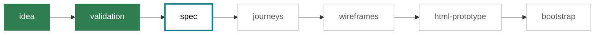

# project
Do nothing yourself. Only call skills.
Only file you touch: `.bootstrap/projects/NN/status.json`, only to mark wireframes or html-prototype `skipped`.
Other skills own their step. Never copy their artifacts.

## steps
Order matters. Skill gets arg NN.
| step id | skill |
|---|---|
| idea | /new-project |
| validation | /validate-idea |
| spec | /write-spec |
| journeys | /draw-journeys |
| wireframes | /draw-wireframes (optional) |
| html-prototype | /build-html-prototype (optional) |
| bootstrap | /bootstrap-project |

## pick
Arg `NN` or slug: use it. Missing: error.
No arg: list `.bootstrap/projects/*/status.json`: id, title, state, next step (first not done, not skipped). Ask which, or `new`.
`new`, or none exist: call /new-project, then continue with the NN it made.

## progress
Show after every skill finishes, on stop, and when listing a project. Print as a ```mermaid block, built from status.json. Not a file.
Node per step in order, label `<step id>`. Class from step status: done, failed, skipped, pending. First pending step after the last done: class next.

Title line above it: `NN <title>: <state>`. Failed step: add its `result` line under the diagram.

## run
1. Read status.json.
2. Walk steps in order. Skip done. Skip skipped.
3. Before wireframes and html-prototype, ask once: `Do <step> or skip?`
   Skip: set that step `skipped`, result `project: skipped NN`. Nothing else.
4. Call step skill with NN. Read its report line.
   Re-read status.json after: skill wrote it.
   Show progress diagram (see progress).
5. Step `failed`, or skill needs input you cannot get: stop.
   Say which skill, why. Say "run /<skill> NN, then run /project NN again".
   Validation RED or failed: also say user can run `/validate-idea NN override`.
6. Step done: next.
7. End: say state is in `.bootstrap/projects/NN/status.json`. After bootstrap: say `repo_path` and `artifacts_path` from it.
