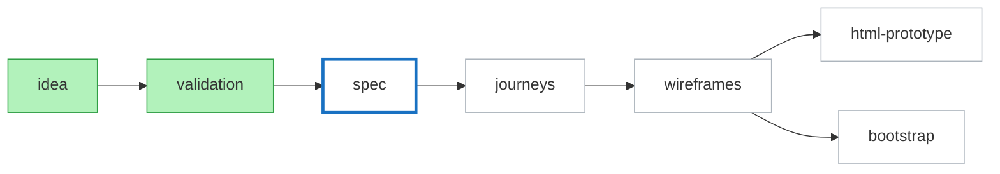

# progress diagram
Draw on Excalidraw canvas. Not in chat. Not in a file.
Tools: mcp__excalidraw__*. Load schemas via ToolSearch `select:` first. None found: use fallback.

## layout
Per project one row. Ids stable, so later runs update, not redraw.
- title text `prj-NN-title`: `NN <title>: <state>`, fontSize 24.
- 7 rectangles `prj-NN-<step id>`, 160x64, text = step id, fontSize 18, gap 60 on x.
  Steps: idea, validation, spec, journeys, wireframes in a row. html-prototype and bootstrap in the next column, stacked: html-prototype 40 above row y, bootstrap 40 below (they run in parallel).
- 6 arrows `prj-NN-a1`..`a6`: a1-a4 neighbours in the row, a5 wireframes -> html-prototype, a6 wireframes -> bootstrap. Bound start/end.
- Running step: text `prj-NN-run` under it, its `thread` value, fontSize 14.
- Failed step: text `prj-NN-fail`, under that rectangle, its `result` line, fontSize 14.

## colors
| status | backgroundColor | strokeColor | strokeStyle | strokeWidth |
|---|---|---|---|---|
| done | #b2f2bb | #2f9e44 | solid | 2 |
| next | #ffffff | #1971c2 | solid | 4 |
| failed | #ffc9c9 | #e03131 | solid | 2 |
| running | #fff3bf | #f08c00 | solid | 3 |
| skipped | #e9ecef | #868e96 | dashed | 2 |
| pending | #ffffff | #adb5bd | solid | 2 |
next = first pending step after last done step. None pending: no next. html-prototype and bootstrap both pending after wireframes: both next.

## run
1. `describe_scene`. Find `prj-NN-title`: `query_elements` type text, match id.
2. Exists: `update_element` per rectangle (colors, strokeStyle, strokeWidth) and title text. Missing id (user deleted it): create again with batch.
   New: origin x = 0, y = scene bounding box bottom + 120 (0 if empty). `batch_create_elements` all elements one call.
3. Failed step: create or update `prj-NN-fail`. Not failed: delete it if present. Same for `prj-NN-run` and running steps.
4. `set_viewport` with `scrollToElementIds` = this project's rectangles.
5. Say in one line: `progress drawn on excalidraw: NN <state>`. No dump of status.json.

## rules
Never clear the canvas. Never touch elements without prefix `prj-`. It may hold other diagrams.
Elements for done steps never deleted.
Tool error (no canvas server): say once, use fallback, go on. Never block pipeline on the diagram.

## fallback
No excalidraw tools: print one mermaid block, tell user `/ensure-mcp excalidraw` for the canvas version.

Class per step from status. Title line above: `NN <title>: <state>`.
